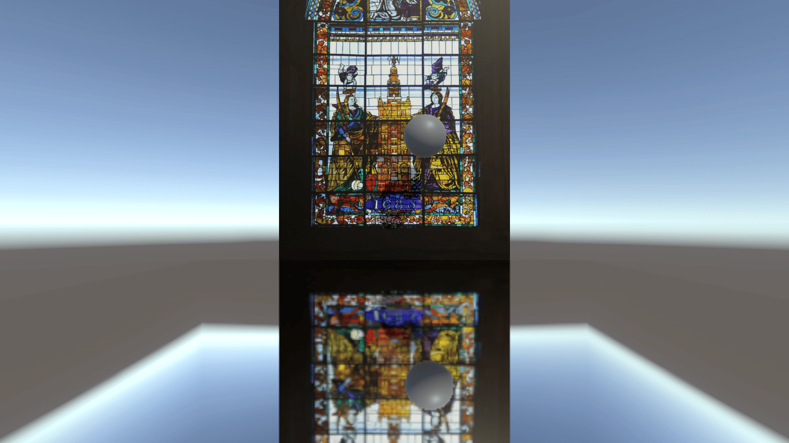

# はじめに
プログラムワークショップⅣの管理用です

# 結果画像

- 作ったもの：雨天時の床
- 工夫した点：
  「───雨が降り、床が濡れだすと テカテカと輝いた床がステンドグラスを反射した...───」 そんなのをテーマに作ってみました。
   時間経過によって床が濡れ始めますが、床のぬれるスピードや濡れ方をインスペクター上で触れるようにしたのがアピールポイントです。

# 進め方

- 本リポジトリをforkしてください
- fork先のリポジトリを更新してください
- Unityのプロジェクトをsrc内で進めてください
- 結果を画面キャプチャして、画像としてリポジトリに追加して、上記のリンクから見られるようにしてください
- 完成したら本リポジトリのmainブランチにpull requestを投げてください
